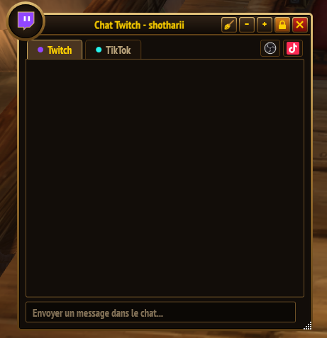
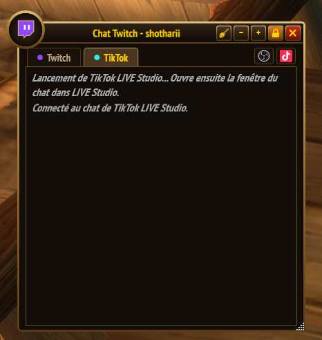
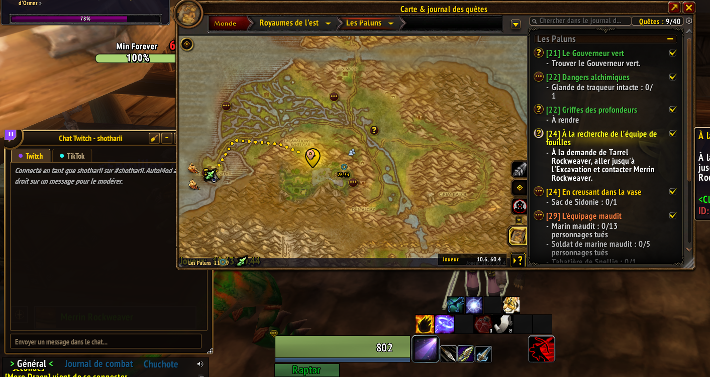
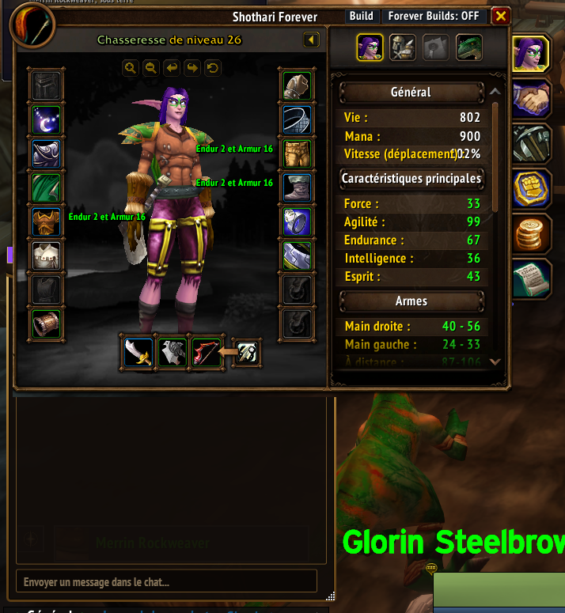
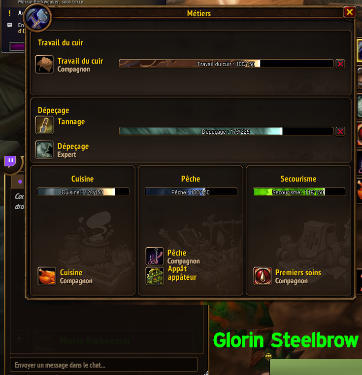
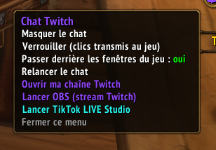

# Twitch Chat WoW

**Ton chat Twitch et ton chat TikTok LIVE, directement dans World of Warcraft (WoW Forever).**

Tu streames en jouant ? Plus besoin de quitter le jeu pour lire ton chat, modérer ou lancer ton live : tout est dans une fenêtre au style de WoW, qui se fond dans ton interface.

Créé par **Shotharii** — viens me voir en live :

### ⬇️ [Télécharger Twitch Chat WoW](https://github.com/Shothari/twitch-chat-wow/raw/main/Twitch-Chat-WoW.zip)

## Ce que ça fait

- **Deux onglets** : Twitch et TikTok, dans une fenêtre au style « Carte & journal des quêtes ».
- **Modération Twitch** : clic droit sur un message pour le supprimer, mettre un timeout (1 min, 10 min, 1 h) ou bannir. Les messages retenus par **AutoMod** s'affichent avec les boutons Autoriser / Refuser.
- **Envoyer des messages** dans ton chat Twitch depuis le jeu.
- **Emotes** Twitch et BetterTTV, **emojis en couleur**.
- **Chat TikTok** lu depuis TikTok LIVE Studio (lecture seule).
- **Intégration au jeu** :
  - la fenêtre apparaît seulement une fois en jeu, et se cache quand WoW n'est plus au premier plan ;
  - elle passe **derrière les fenêtres du jeu** (fiche perso, carte, métiers…), puis revient devant quand tu cliques dessus ;
  - bouton autour de la **minimap** : afficher / masquer, verrouiller (les clics passent au jeu), relancer, ouvrir ta chaîne Twitch, lancer OBS, lancer TikTok LIVE Studio.
- **Boutons** dans la fenêtre : vider le chat (balai), transparence − / +, cadenas, lancer OBS, lancer TikTok LIVE Studio.
- Se lance **tout seul avec le jeu**.

## Captures d'écran

<table>
<tr>
<td align="center"> <b>Onglet Twitch</b> : modération, AutoMod, bouton pour vider le chat et icônes OBS / TikTok LIVE Studio</td>
<td align="center"> <b>Onglet TikTok</b> : le chat de ton LIVE TikTok, via TikTok LIVE Studio</td>
</tr>
</table>

**Intégration totale** : le chat passe derrière les fenêtres du jeu (carte, fiche personnage, métiers…) et revient devant d'un simple clic.

<table>
<tr>
<td align="center"> Derrière la fiche personnage</td>
<td align="center"> Derrière la fenêtre des métiers</td>
</tr>
</table>

## Installation

1. Télécharge **[Twitch-Chat-WoW.zip](https://github.com/Shothari/twitch-chat-wow/raw/main/Twitch-Chat-WoW.zip)** et décompresse-le.
2. Mets le dossier **`Twitch Chat WoW`** dans
   `World of Warcraft\_forever_\Interface\AddOns`.
3. Double-clique **une seule fois** sur **`INSTALLER (une seule fois).bat`** dans ce dossier.
4. Lance le jeu. Au premier lancement, une page Twitch s'ouvre : connecte-toi avec **ton** compte et clique sur *Autoriser*.

C'est tout : la fenêtre s'ouvrira ensuite toute seule à chaque partie.

> WoW doit être en mode **fenêtré (plein écran)** pour que la fenêtre du chat s'affiche par-dessus.

## TikTok

Le chat TikTok est lu depuis **TikTok LIVE Studio** (nécessaire pour streamer sur TikTok).
Lance LIVE Studio avec le raccourci **« TikTok LIVE Studio (Chat WoW) »** créé sur ton bureau par l'installateur, ou avec l'icône TikTok de la fenêtre / le menu de la minimap, puis ouvre la fenêtre du chat dans LIVE Studio.
La modération TikTok se fait dans LIVE Studio.

## Commandes en jeu

Tout se fait aussi depuis le **bouton de la minimap** (clic droit pour ouvrir le menu) :
masquer, verrouiller, passer derrière les fenêtres du jeu, relancer, ouvrir ta chaîne, lancer OBS ou TikTok LIVE Studio.

| Commande | Effet |
|---|---|
| `/twitch` | afficher / masquer |
| `/twitch lock` / `unlock` | verrouiller / déverrouiller |
| `/twitch relancer` | relancer la fenêtre du chat |
| `/twitch chaine` | ouvrir ta chaîne Twitch |
| `/twitch obs` | lancer OBS |
| `/twitch tiktok` | lancer TikTok LIVE Studio |
| `/twitch bouton` | masquer / afficher le bouton de la minimap |

Raccourci clavier : **Ctrl + Alt + T** pour afficher / masquer la fenêtre.

 

## Désinstaller

Double-clique sur `Programme\Desinstaller.bat`, puis supprime le dossier `Twitch Chat WoW`.

## Comment ça marche

Un addon WoW n'a pas accès à Internet. Le dossier contient donc deux parties :
- **l'addon** (Lua) : bouton de minimap, et une petite bande de pixels colorés en haut à gauche de l'écran qui transmet son état et la position des fenêtres du jeu ;
- **le programme** (PowerShell, dans `Programme\`) : la fenêtre du chat, connectée à Twitch (EventSub + API Helix) et à TikTok LIVE Studio (en local).

Ta connexion Twitch est enregistrée chiffrée (DPAPI Windows) sur ton PC, dans `Programme\twitch-token.dat`, et n'est jamais partagée.

Windows uniquement.

## Me suivre

Si l'addon te plaît, passe dire bonjour en live :
- **Twitch** : [twitch.tv/shotharii](https://www.twitch.tv/shotharii)
- **TikTok** : [tiktok.com/@shothari](https://www.tiktok.com/@shothari)
